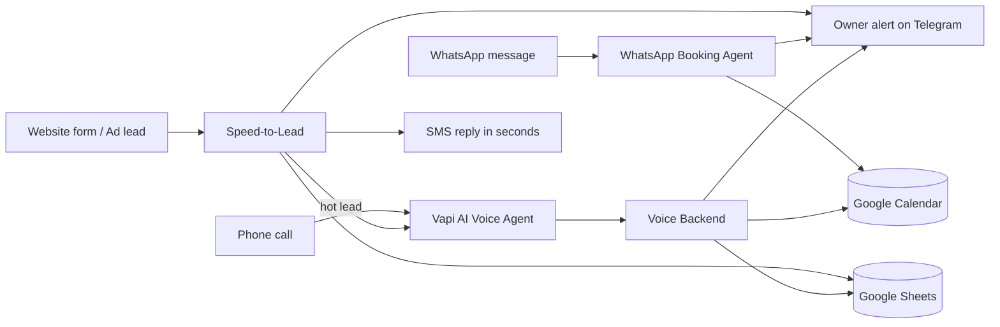

<div align="center">

# 📞 AI Receptionist Automation

**Never miss a lead again.** A free, open-source AI receptionist for small businesses: it texts new leads back in seconds, books appointments on WhatsApp, and answers your phone with an AI voice agent.

Built with [n8n](https://n8n.io) · Google Gemini · Vapi · Twilio · WhatsApp Cloud API · Google Calendar


⭐ **If this saves you time, star the repo so other business owners can find it.**

</div>

---

## Why this exists

Most small businesses lose customers in the first few minutes:

- A lead fills a form at 9 pm and nobody replies until tomorrow.
- A customer sends a WhatsApp message asking for a booking and waits hours.
- The phone rings while you are busy with another client, and the caller goes to a competitor.

This kit puts an AI receptionist on all three channels. It replies instantly, qualifies the lead, books the appointment in your Google Calendar, and sends you a short summary on Telegram. You stay in control and only step in when it matters.

Works for clinics, dentists, salons, spas, HVAC, plumbers, cleaners, real estate agents, law firms, coaches and any business that books appointments.

## What's inside

| # | Workflow | What it does |
|---|---|---|
| 1 | [**Speed-to-Lead Responder**](workflows/01-speed-to-lead-responder.json) | Any website form, landing page or ad sends a lead to a webhook. AI scores it hot, warm or cold, texts the lead back by SMS within seconds, logs it to Google Sheets, alerts you on Telegram, and calls hot leads with an AI voice agent. |
| 2 | [**WhatsApp Booking Agent**](workflows/02-whatsapp-booking-agent.json) | An AI receptionist on your WhatsApp Business number. Answers questions only from your business info, checks Google Calendar, books appointments, remembers the conversation, and hands off to a human when needed. Replies in the customer's language. |
| 3 | [**AI Phone Receptionist (Vapi backend)**](workflows/03-voice-agent-backend-vapi.json) | The backend for an AI voice agent that answers your phone. It checks your calendar and books appointments during the call, then logs the call summary, recording and transcript and sends you a summary. |

## How it works



## Quick start

1. **Get n8n.** Use [n8n Cloud](https://n8n.io) or self-host it (free).
2. **Import a workflow.** In n8n: *Create workflow → ⋯ → Import from file*, then pick a JSON file from [`workflows/`](workflows).
3. **Fill in Business Settings.** Every workflow has a **Business Settings** node. Replace each `REPLACE_ME` value with your business name, services, hours, time zone, booking link and Telegram chat ID.
4. **Connect your accounts.** Add credentials for the services that workflow uses (see the table below).
5. **Activate** the workflow and test it.

### Accounts you need

| Service | Used by | Free tier |
|---|---|---|
| Google Gemini API | 1, 2 | Yes |
| Google Sheets | 1, 3 | Yes |
| Google Calendar | 2, 3 | Yes |
| Telegram bot (owner alerts) | 1, 2, 3 | Yes |
| Twilio (SMS) | 1 | Trial credit |
| WhatsApp Business Cloud API | 2 | Free tier |
| Vapi (AI phone calls) | 1, 3 | Trial credit |

You can swap any of these. For example, replace Telegram with Slack or email, or Gemini with OpenAI, by changing one node.

### Google Sheet

Create one spreadsheet with two tabs: **Leads** and **Calls**. Columns are created automatically on the first run.

## Setup details

<details>
<summary><b>1. Speed-to-Lead Responder</b></summary>

Send a POST request to the webhook from your form, landing page, Facebook Lead Ads (via a connector) or website:

```bash
curl -X POST https://YOUR-N8N-DOMAIN/webhook/new-lead \
  -H "Content-Type: application/json" \
  -d '{"name":"Sarah","phone":"+14165550123","email":"sarah@example.com","message":"My AC stopped working, can you come today?","source":"website"}'
```

The lead gets an SMS within seconds. Hot leads also get an AI phone call if you set a Vapi assistant ID and phone number ID in Business Settings. Leave them empty and remove the last node if you only want SMS.

</details>

<details>
<summary><b>2. WhatsApp Booking Agent</b></summary>

1. Create a WhatsApp Business app in [Meta for Developers](https://developers.facebook.com) and get a phone number ID and access token.
2. Add the **WhatsApp OAuth** credential to the trigger and the **WhatsApp API** credential to the reply node.
3. Put your services, prices, hours, address and policies in `businessInfo`. The AI only answers from this text, so it never makes up prices.
4. Pick your calendar in `check_availability` and `book_appointment`.

</details>

<details>
<summary><b>3. AI Phone Receptionist with Vapi</b></summary>

1. In [Vapi](https://vapi.ai), create an assistant and attach a phone number.
2. Set the assistant **Server URL** to your n8n production webhook: `https://YOUR-N8N-DOMAIN/webhook/vapi-receptionist`.
3. Turn on the **end-of-call-report** server message.
4. Add two **function tools** to the assistant:

```json
{
  "name": "check_availability",
  "description": "Check if a time slot is free. Use ISO 8601 date-times in the business time zone.",
  "parameters": {
    "type": "object",
    "properties": {
      "start": { "type": "string", "description": "Slot start, e.g. 2026-11-26T16:00:00-05:00" },
      "end": { "type": "string", "description": "Slot end" }
    },
    "required": ["start", "end"]
  }
}
```

```json
{
  "name": "book_appointment",
  "description": "Book the appointment after the caller confirms the time.",
  "parameters": {
    "type": "object",
    "properties": {
      "start": { "type": "string" },
      "end": { "type": "string" },
      "name": { "type": "string" },
      "phone": { "type": "string" },
      "service": { "type": "string" },
      "notes": { "type": "string" }
    },
    "required": ["start", "end", "name"]
  }
}
```

5. Example system prompt for the assistant:

```text
You are the friendly receptionist for {Business name}. Today is {{"now" | date: "%A, %B %d, %Y"}}.
Services, prices and hours: {your business info}.
Help callers with questions and book appointments. Ask for their name, the service and a preferred time.
Always call check_availability before offering a time, and only call book_appointment after the caller confirms.
If they want a human or you cannot help, take a message and say the team will call back.
Keep answers short and natural. Never invent prices.
```

</details>

## FAQ

**Is it free?** The workflows are free and MIT licensed. You only pay for the services you use (SMS, phone minutes, AI tokens). Most have free tiers or trial credit.

**Can I use OpenAI or Claude instead of Gemini?** Yes. Replace the Gemini Model node with any chat model node in n8n.

**Can I sell this to clients?** Yes. MIT license. Agencies use setups like this to offer AI receptionist and speed-to-lead services.

**Does the AI make things up?** The WhatsApp agent is told to answer only from your business info and hand off to a human otherwise. Always test with real questions before going live.

## Roadmap

- [ ] Missed-call text-back (SMS when a call is not answered)
- [ ] Appointment reminders and no-show follow-ups
- [ ] Google review requests after a visit
- [ ] Rescheduling and cancellations by WhatsApp

Ideas and pull requests are welcome. Open an [issue](../../issues) with the workflow you want next.

## License

[MIT](LICENSE). Free to use, change and sell.

<div align="center">

Built by [Muhammad Zohaib](https://github.com/Zohaib-mzb) · [LinkedIn](https://linkedin.com/in/muhammad-zohaib-butt)

⭐ Star the repo if it helped you.

</div>
